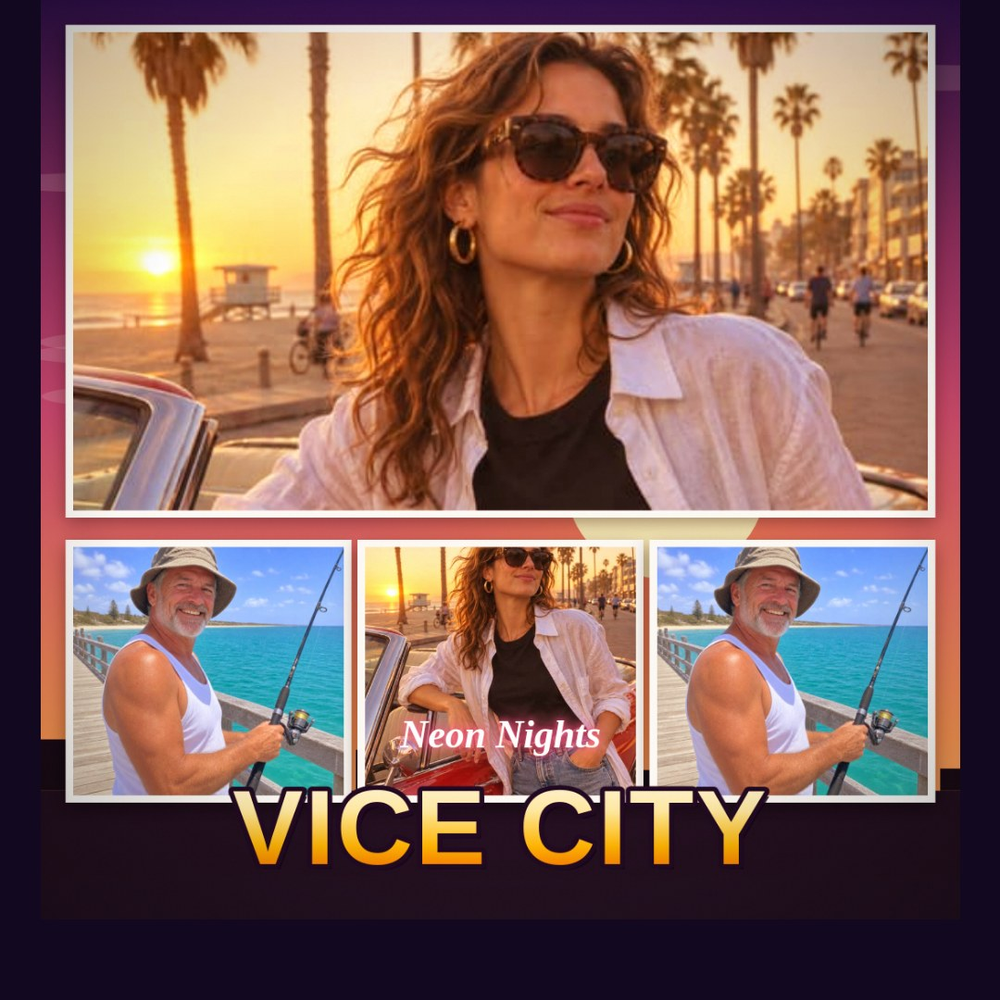
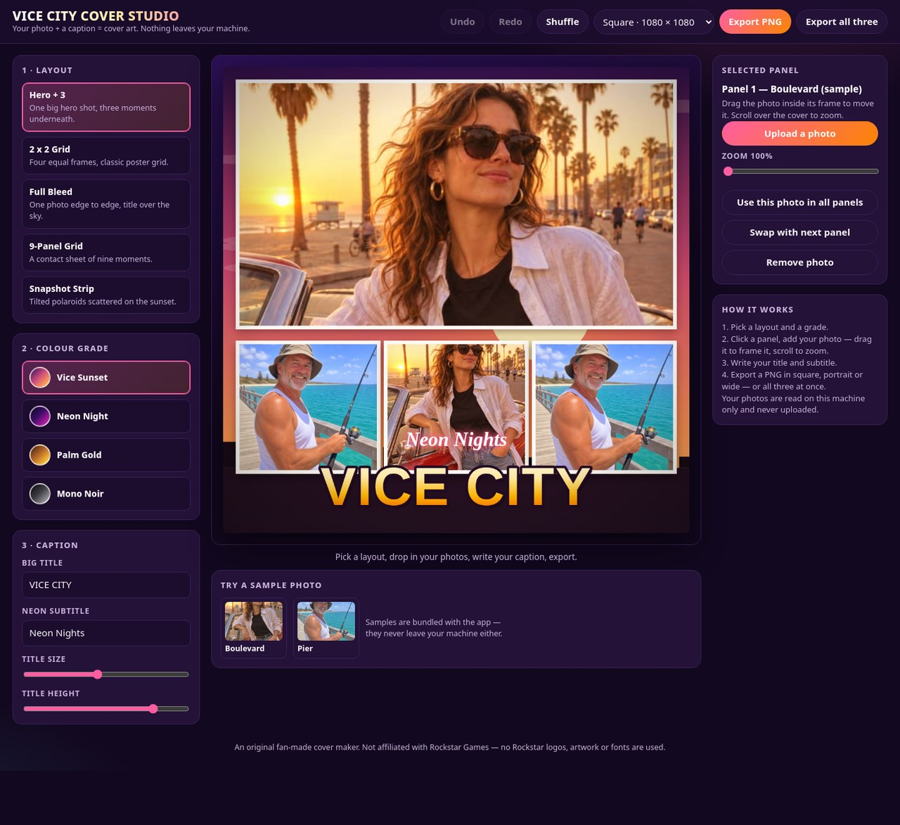
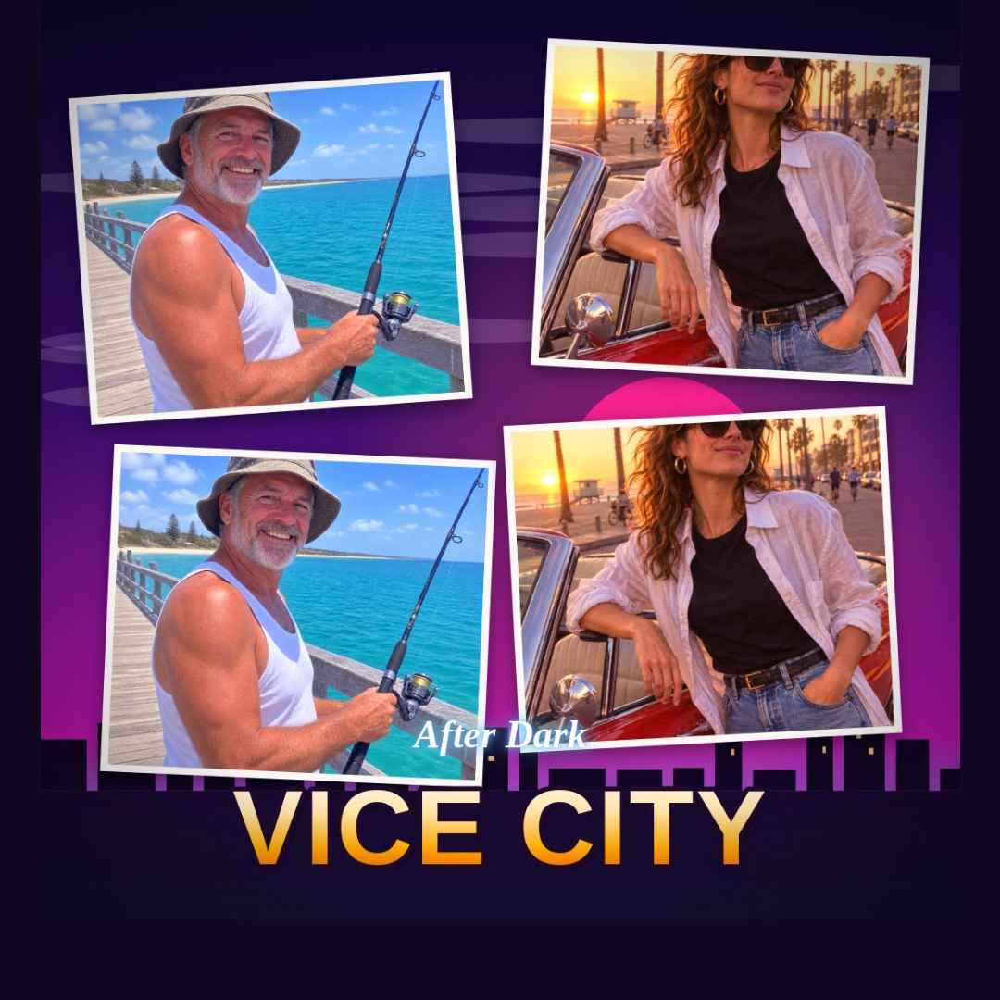

[](https://make.fun/bounty/gta6-cover-art-01?utm_source=github&utm_medium=readme&utm_campaign=gta6-cover-art-01)
[](https://make.fun/bounty/gta6-cover-art-01?utm_source=github&utm_medium=readme&utm_campaign=gta6-cover-art-01)
[](https://make.fun/bounty/gta6-cover-art-01/leaderboard?utm_source=github&utm_medium=readme&utm_campaign=gta6-cover-art-01)
[](https://make.fun/bounty/gta6-cover-art-01?utm_source=github&utm_medium=readme&utm_campaign=gta6-cover-art-01)

# Vice City Cover Studio

Turn your own photo and a caption into GTA 6-style cover art — the multi-panel poster look, bold caption lettering, and a Vice City sunset or neon colour grade — then export it as a PNG to share.

Built for the [make.fun "Make GTA 6 Cover Art" bounty](https://make.fun/bounty/gta6-cover-art-01).

## What it does

- **Multi-panel covers** — pick from five layouts: hero + three panels, a 2×2 grid, full-bleed photo, a 9-panel cover grid, or a tilted snapshot strip.
- **Any photo** — drop in your own photos from your machine. Crop, zoom, and drag each photo into place, per panel. One photo can fill every panel, or each panel can hold a different photo.
- **Colour grades** — Vice Sunset, Neon Night, Palm Gold, and Mono Noir, with film grain and vignette on top.
- **Bold captions** — edit the title, subtitle, size, and position. Big condensed lettering with outline and drop shadow, plus a neon script subtitle.
- **One-step export** — PNG in the common post sizes: 1080×1080, 1080×1350, and 1920×1080.
- **Undo / redo** — every edit is reversible.
- **Two sample photos included** — try it instantly without uploading anything.

## Run it offline

No build step, no network, no upload. Your photos never leave your machine.

```bash
node serve.ts
```

Then open http://localhost:8080 in desktop Chrome. Everything the app loads — scripts, styles, samples — is a file in `app/`.

## How to make a cover

1. Pick a layout (hero, grid, full-bleed, 9-panel, or snapshot strip).
2. Add your photo — drag it into a panel, then drag and zoom to frame it.
3. Type your caption, pick a colour grade.
4. Hit **Export PNG** and share it.

## Screenshots

| | |
| --- | --- |
|  |  |
| Exported cover, 1080×1080 | Editor with a photo loaded |
|  | |
| Second cover variant, neon grade | |

## Project layout

- `app/` — the web app (static files only: `index.html`, `style.css`, `src/*.js`, sample photos under `app/samples/`)
- `screenshots/` — the three screenshots above, taken from the app itself
- `shots.json` — the scene list used to capture the screenshots
- `main.ts` — hands the app in: copies `app/` + `screenshots/` to `/output` and writes `/output/dossier.json`
- `serve.ts` — serves the app locally for trying it out
- `vendor/makefun-app.ts` — the kit's dossier library, unchanged

## Notes

- This is a fan-made tool. It is **not affiliated with, endorsed by, or connected to Rockstar Games**. It uses no Rockstar logo, artwork, or font — all lettering uses system font stacks and the art is original.
- The photos in the screenshots are the kit's free-to-use sample photos.

---

Made for make.fun — if you enter a bounty too, my referral code is `5c2wyg2x`.
